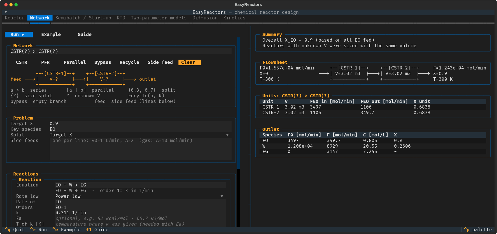

# EasyReactors

Chemical reactor design in the terminal. Type the reactions and the feed, press Run, get tables, plots and a
sketch of the flowsheet. Also usable as a Python library.



## Install and run

```
pip install git+https://github.com/eggplanta/EasyReactors
easyreactors
```

Python 3.12+. With [uv](https://docs.astral.sh/uv/): `uv run easyreactors` inside the repo.

Each tab has **Example** (fills a solved case), **Run** and **Guide**. Values take any unit: `800 gallon`,
`25 degC`, `0.311 1/min`. Keys: `Ctrl+R` run, `Ctrl+E` example, `F1` guide.

## Tabs

- **Reactor**: batch, CSTR, PFR or packed bed (PBR). Simulate a given size, size for a target conversion, or
  find the size that maximizes an intermediate. Any number of reactions, power law, reversible, LHHW or a free
  rate expression. Optional energy balance (adiabatic or heat exchange) with every CSTR steady state, and
  Ergun pressure drop for a PBR.
- **Network**: reactors in series, parallel, with recycle, bypass or side feeds, written as `CSTR(?) > PFR(50)`.
  Unknown volumes are sized for a target conversion and the flowsheet is drawn.
- **Semibatch / Start-up**: semibatch reactor and CSTR start-up, with the time to reach steady state.
- **RTD**: E(t), F(t), mean residence time and variance from tracer data; conversion by segregation, maximum
  mixedness, tanks in series and dispersion.
- **Two-parameter models**: fits ideal reactor combinations (bypass, dead volume, exchange) to tracer data.
- **Diffusion**: Thiele modulus and effectiveness factor, Weisz-Prater and Mears criteria, mass-transfer
  correlations, packed bed with internal and external resistances.
- **Kinetics**: reaction order and k from C(t) data (differential, integral, nonlinear regression), rate-law
  fits from rate data, and Arrhenius.

## Library

Usage without the UI:

```python
from easyreactors import to_si
from easyreactors.core import PowerLaw, Reaction, ReactionSet
from easyreactors.reactors import CSTR, Stream

k = to_si("0.311 1/min", "1/s")
rxn = ReactionSet([Reaction("EO + W -> EG", PowerLaw(k, {"EO": 1}))])
feed = Stream.liquid(v0="7.24 L/s", T="300 K", C={"EO": "8.05 mol/L", "W": "27.8 mol/L"})
print(CSTR(rxn).size(feed, X=0.8).end)  # 5.59 m3
```

Streams and reactor sizes accept units; rate constants and results are in SI.

## Validation

The test suite (`uv run pytest`) checks the results against worked examples from Fogler, *Elements of Chemical
Reaction Engineering*, 5th ed. Where a number differs, the test explains why (usually rounding in the book).
